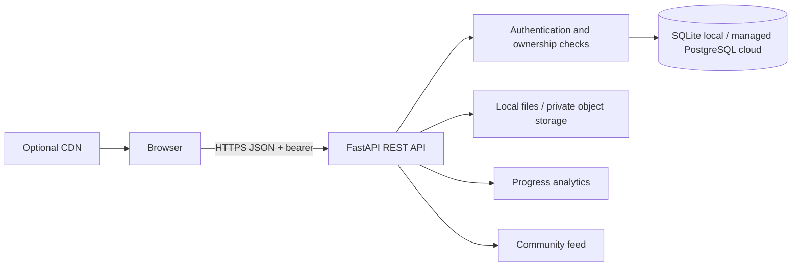

# Online Hobby & Skills Tracker with Community Sharing on Cloud

Growlog is a local-first learning community: create a profile, track skills and practice, set goals, share achievements, and see progress analytics. FastAPI + SQLAlchemy API, browser frontend, SQLite and local uploads make the complete demo runnable without a paid account. PostgreSQL and private object storage are the production path.

## Problem and solution

Practice history is often split between notes, timers, and social sites. This app centralizes it so a learner can sign in from multiple devices, track progress and share chosen achievements. In a hosted deployment, a managed relational database holds structured records and object storage holds file bytes. The API authorizes every user-owned operation.

## Features

- Registration/login, salted PBKDF2 password hashes, expiring signed bearer tokens, profile editing and public profile projection.
- User-scoped skills, hourly goals, milestones, practice records, streaks and analytics.
- Community posts, filtered/paginated feed, likes with uniqueness constraint, comments and optional follows.
- JPEG/PNG/PDF local upload simulation with a 5 MiB limit and content-signature validation.
- Responsive dashboard and interactive REST docs at `/docs`.

## Architecture



The browser never accesses the database directly. A cloud deployment can add a CDN, API gateway/load balancer, managed identity, private bucket with short-lived signed URLs, managed database, secrets manager, backups and monitoring.

## Technology options

| Option | Architecture | Difficulty / cost | Tradeoffs |
|---|---|---|---|
| A Beginner | HTML/CSS/JS, Flask, SQLite, local files | Low, free locally | Easiest to learn; no hosted durability |
| B Student cloud | React, FastAPI, Supabase Auth/Postgres/Storage or Firebase equivalents | Medium; check current quotas/pricing | Managed identity/data/files, provider limits and policies vary |
| C Advanced | React/Next, FastAPI/Lambda, Cognito, API Gateway, RDS/DynamoDB, S3, CloudFront, CloudWatch | High; usage may cost money | Strong managed scaling; IAM and billing complexity |

The included implementation uses FastAPI, SQLite, local files, and a plain HTML/CSS/JavaScript frontend. It is a local simulation rather than a deployed cloud service. PostgreSQL support is available with `DATABASE_URL` after installing the PostgreSQL driver; private cloud object storage still needs a provider adapter before public deployment.

## Data model and progress

`users` 1—N skills, goals, practice, posts, comments; skills 1—N goals/sessions; goals 1—N milestones; posts 1—N likes/comments; follows connect users. Integer primary/foreign keys maintain relationships; email/username and `(user_id, post_id)` are unique. Owner IDs, relationship keys and post timestamps are indexed. Practice history is the source of truth: hourly progress is `sum(duration_minutes)/60`; displayed progress is capped at 100%. Current streak counts consecutive server-calendar dates ending today, or yesterday when today has no practice. Longest streak scans unique practice dates. User time zones are not currently stored.

## Local setup (PowerShell)

Install Python 3.11+ and Git. No Node install is needed.

```powershell
py -3 -m venv .venv
.\.venv\Scripts\Activate.ps1
python -m pip install -r requirements.txt
Copy-Item .env.example .env
uvicorn backend.app:app --reload
```

Edit `.env` and replace `APP_SECRET` with a random secret before running. Open `http://127.0.0.1:8000`, register two synthetic users in separate browser profiles, add a Photography skill, create a 20-hour goal, log 60 minutes, and view its progress. Share a post; sign in as the second user, like and comment. API docs: `/docs`; health: `/api/health`. Run automated tests: `python -m pytest -q`. Delete ignored `tracker.db` and upload files to reset. Environment values are loaded from `.env`; operating-system variables override them.

## Configuration and API

Copy `.env.example` to `.env`: `APP_SECRET` signs 24-hour tokens; `DATABASE_URL` selects SQLite/PostgreSQL (PostgreSQL uses the `psycopg` driver in requirements); `UPLOAD_DIR` sets local file path; `CORS_ORIGINS` is an allowlist. Production secrets belong in a secret manager. Routes: `POST /api/register`, `/api/login`, `/api/logout`; `GET/PUT /api/profile`; `GET /api/users/{username}`; skill CRUD at `/api/skills`; goals at `/api/goals`; practice at `/api/practice`; posts at `/api/posts`; feed at `/api/feed`; likes/comments under `/api/posts/{id}`; upload at `/api/files/upload`; analytics at `/api/analytics/dashboard`. JSON requests receive 422 validation errors; missing/invalid auth 401; forbidden ownership 403 or concealed 404; duplicate registration 409; invalid upload type/size 415/413. FastAPI exposes request/response schemas in `/docs`.

## Security and privacy

Passwords use PBKDF2-HMAC-SHA256 and random salts. Signed tokens expire after 24 hours. Private queries filter by the authenticated user; public profile responses omit email. Post/comment deletion enforces ownership, and a DB unique constraint prevents duplicate likes. Upload validation checks allowed content types, byte signature and size; generated names avoid path traversal. The local uploads endpoint is a simulation, not production private storage. Production should use private buckets, short-lived signed URLs, TLS, encryption at rest, rate limits, moderation/report/block controls, malware scanning, token revocation/refresh, audit logs, account/data deletion and backup restore drills. User-generated content needs XSS-safe rendering, spam controls and moderation. Never put real credentials or personal content in sample data.

## Deployment and cloud concepts

Student path (future cloud adaptation): host this FastAPI app and connect managed PostgreSQL; the included app currently uses its own bearer-token auth and local filesystem uploads, not Supabase/Firebase Auth or cloud object storage. Add and test a private storage adapter with signed URLs before treating uploaded media as cloud-persistent. Check current free quotas/payment terms; configure TLS, CORS, backups, storage policies and secret management.

AWS reference: S3/CloudFront frontend, Cognito auth, API Gateway + Lambda (or App Runner), RDS/DynamoDB, private S3 with pre-signed URLs, optional ElastiCache, CloudWatch and Secrets Manager. Azure: Static Web Apps/CDN, Entra External ID, Functions/API Management, PostgreSQL/Cosmos DB, Blob, Monitor/Key Vault. GCP: Firebase Hosting/Cloud CDN, Identity Platform, Cloud Run/API Gateway, Cloud SQL/Firestore, Cloud Storage, Monitoring/Secret Manager. Services can incur charges; add budget alerts and teardown steps.

| Concept | Demonstration |
|---|---|
| Cloud, SaaS, PaaS, IaaS | This local simulation is not itself a cloud service; when hosted it can be offered as SaaS. Managed database/hosting are PaaS; VM/network provisioning is IaaS in the advanced variant |
| Client-server, REST, authN/authZ | Browser calls API; bearer token identifies caller and owner checks authorize resources |
| Cloud DB/object store | SQLite/local files simulate; use managed Postgres and private object storage in cloud |
| Serverless/event-driven | Lambda alternative; enqueue image scan/achievement notification on upload/post |
| Scale/elasticity/availability | Stateless API replicas and managed DB; multi-zone service and backups improve uptime |
| CDN/load balancer/API gateway | Advanced deployment edge-caches static assets, routes and balances API calls |
| Caching/indexes/pagination | Owner/time indexes and bounded feed pages; Redis/keyset pagination at higher scale |
| Environment/secrets/logging/monitoring | `.env.example`; production secret manager, structured logs, metrics and alarms |
| Backup/CI/CD | Managed snapshots, restore checks, pipeline for lint/test/build/deploy |

This architecture also fits EdTech, LMS, fitness, creator, employee learning and portfolio products. At a million posts, use keyset pagination, indexes, cached/denormalized counters, background queues and moderation. Fan-out-on-read computes feed from followed users at read time (simpler writes); fan-out-on-write precomputes followers’ feeds (faster reads, expensive celebrity writes). Begin with indexed read-time queries.

## Tests, screenshots and GitHub

`tests/test_api.py` covers registration, duplicate/login, data isolation, goals/practice/analytics, community likes/comments, ownership and validation. See `docs/TEST_PLAN.md` for 27 manual cases and recording fields. Capture real screenshots in `screenshots/`: login, dashboard, skill/goal progress, two-user sharing, `/docs`, passing tests and deployment console only after deployment. No fabricated evidence is included.

Current local UI captures: [registration](screenshots/01-registration-screen.png), [demo registration form](screenshots/02-demo-registration.png), [dashboard](screenshots/03-dashboard-empty-state.png), [practice entry](screenshots/04-practice-session-entry.png), and [second-user dashboard](screenshots/05-second-user-dashboard.png). Recapture skill/goals and community screenshots after seeding a clean demo; these files demonstrate local UI only, not cloud deployment.

Folders: `backend/` API/data/auth; `frontend/` browser UI; `tests/`; `screenshots/`; `docs/` architecture, deployment and verification guides; `reports/` project report and placement content. There is one project README at the root; technical details live in the relevant guides, not duplicate subfolder READMEs.

Known limits: SQLite/local files are for simulation. Add schema migrations, actual private cloud storage, full report/block/admin moderation, account deletion, token revocation, rate limiting, CI/CD, observability and cloud restore test for production readiness.


Build truthful incremental commits: architecture, authentication, profiles, skills, practice, goals, database, storage, posts, reactions, analytics, security, tests, deployment, docs. See `reports/PROJECT_REPORT.md` and `reports/PLACEMENT.md`.

## Author

**Name:** Your Name   
**Course:** B.Tech in Computer Science


